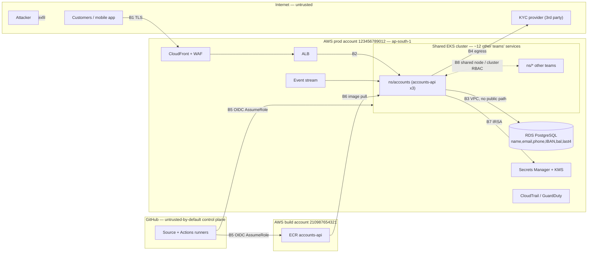

# Threat model — `accounts-api`

Scope: the container, the pipeline that produces it, the identities it assumes, the data it holds.
Every control in sections 2–6 carries a `T#` tag back to this page. See [`TRACEABILITY.md`](TRACEABILITY.md).

## Trust boundaries

<!-- Rendered fallback for viewers that do not draw Mermaid (PDF, some editors).
     Regenerate both with: scripts/render-diagrams.sh -->

| id | boundary | crossing principal |
|----|----------|--------------------|
| B1 | internet → edge | anonymous, then authenticated customer |
| B2 | edge → workload | ALB SA / mTLS-less HTTP inside VPC |
| B3 | workload → data | DB credential (rotated, from Secrets Manager) |
| B4 | workload → internet | pod egress, only `kyc.example-kyc.com:443` is legitimate |
| B5 | GitHub → AWS | federated OIDC web identity, no static keys |
| B6 | registry → cluster | image digest + cosign signature |
| B7 | pod → AWS APIs | IRSA / EKS Pod Identity role |
| B8 | namespace → namespace | Kubernetes RBAC, network policy, node kernel |

## Top five threats, ranked by probability × reach

| # | threat | entry point | what they reach | control in this submission |
|---|--------|-------------|-----------------|----------------------------|
| **T1** | **CI/CD identity abuse.** A compromised third-party Action, a `pull_request_target` workflow, or a maintainer account takeover assumes the deploy role. | B5 — GitHub Actions runner | ECR push, `kubectl apply` in prod, everything the deploy role can reach. Beats every runtime control because it *is* the deploy path. | `sub` pinned to `repo:example-bank/accounts-api:ref:refs/heads/main` **and** `:environment:production`, `aud` asserted, all actions SHA-pinned, `permissions: {}` default, no `pull_request_target`. [`iam/github-oidc-trust-policy.json`](iam/github-oidc-trust-policy.json), [`.github/workflows/build-release.yml`](.github/workflows/build-release.yml) |
| **T2** | **Pod identity over-permission → lateral movement in a shared cluster.** RCE/SSRF/deserialisation in `accounts-api`, or in any of the dozen co-tenant services, then use of the pod's AWS role and Kubernetes RBAC. | B2 → B7/B8 | Original IAM policy = `NotAction` on `*` ≈ account takeover. Original RBAC = `*` on `secrets` in the namespace. `hostPath /var/run/docker.sock` = node takeover = every other team's pods. | Rewritten least-privilege pod policy ([`iam/pod-identity-policy.json`](iam/pod-identity-policy.json)), namespaced RBAC with no wildcards, Kyverno enforcing no-hostPath / no-hostNetwork / non-root / no-privilege-escalation ([`policy/kyverno/policies/`](policy/kyverno/policies)). |
| **T3** | **Direct database exposure.** `publicly_accessible = true` + `0.0.0.0/0:5432` + `storage_encrypted = false` + a static password in a variable. | B3, bypassing B1/B2 entirely | The whole customer dataset — IBAN, PII, last-4 — with no application exploit at all. Internet-wide scanners find this in hours. | Fixed Terraform ([`terraform/`](terraform)) and, more importantly, Rego policies that fail the plan on recurrence ([`policy/rego/terraform.rego`](policy/rego/terraform.rego)) with bad/good fixtures. |
| **T4** | **Unsigned or mutable artefact.** `:latest` tag, no signature, no SBOM. Anyone with registry write, or anyone who can mutate a tag, changes what runs in prod without touching Git. | B6 | Arbitrary code in the pod → immediately T2. | ECR tag immutability, deploy by digest only, cosign keyless signing bound to the workflow identity, SBOM as an in-toto attestation, Kyverno `verifyImages` with the issuer/subject pinned. Scope and limits stated honestly in [`docs/02-build-integrity.md`](docs/02-build-integrity.md). |
| **T5** | **PII / cardholder-adjacent data leaking through logs and egress.** The service logs request context; the pod may egress anywhere. Also the exfil half of T2. | B4 and the log pipeline | Bulk IBAN + PII, no exploit needed — a `log.Info(ctx, req)` in a hot path is enough. Under RBI localisation this is also a residency incident, not only a privacy one. | Allowlist log serialiser at the app layer + Fluent Bit redaction filter, with residual leaks named ([`docs/06-log-redaction.md`](docs/06-log-redaction.md)); default-deny egress NetworkPolicy + Istio egress gateway pinning the one KYC FQDN ([`k8s/`](k8s), [`docs/05-egress.md`](docs/05-egress.md)). |

### Accepted, not controlled

* **Compromise of the KYC provider itself.** We control what we send and where we send it (T5 egress pin), not their breach. Compensating: field minimisation in the KYC call and a contractual breach-notification SLA — noted, not built.
* **Malicious insider on the platform team with cluster-admin.** Detective only: CloudTrail + EKS audit log to a separate log-archive account with an org SCP denying `s3:DeleteObject`, plus two-person review on the policy repo (CODEOWNERS). Prevention would need break-glass-only admin with session recording; deprioritised for time (see `DECISIONS.md` §6).

### One threat I think is overrated here

**Container escape via a kernel or runtime 0-day.** It gets the most attention in bank threat decks and the least value per pound spent in this architecture. On managed EKS with vendor-patched AMIs, escape is a *second* step in a chain whose *first* step is RCE in the pod — and once an attacker has RCE, the pod's AWS identity (T2) and the database credential already hand them the entire customer dataset. Escaping to the node adds the other teams' workloads; it does not add *this* service's data. So I spend the budget on scoping the identity and the egress, which cut the value of both steps, rather than on gVisor/Kata sandboxing, which cuts only the second and costs a cluster-wide migration on a platform shared with twelve other teams. Same reasoning, shorter: I would rather make RCE worth little than make escape hard.

*(Consequence I accept: a co-tenant service's escape reaches my node. Mitigated cheaply — the fixed manifest drops `hostPath`, `hostNetwork` and root, and the Falco rule in [`runtime/`](runtime) fires on the escape primitives rather than on the exploit.)*
